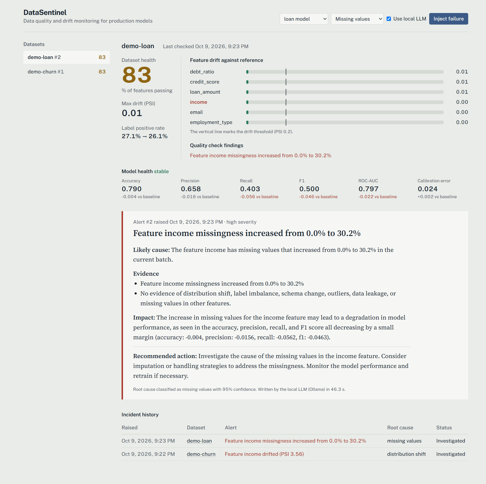

# DataSentinel AI

DataSentinel AI monitors the data that feeds an ML model. It detects schema changes, data-quality problems, distribution drift and model-performance degradation. An investigation agent then explains the likely cause, the evidence for it, the impact on the model, and what to do next.

The agent runs on a **free local model through [Ollama](https://ollama.com)**, `qwen2.5:3b` by default. It needs no paid API.

```text
data batch → quality + schema checks → drift (PSI, KS, label) → model metrics → alert
           → investigation agent (Ollama, rule-based fallback) → incident report → dashboard
```



## What it checks

| Area | Checks |
| --- | --- |
| Data quality | Missing-value spikes, duplicate rows, values far outside the reference range, cardinality changes, label leakage |
| Schema | Added, removed and retyped columns |
| Drift | PSI with reference-quantile bins, two-sample KS test, categorical PSI, label positive-rate drift |
| Model | Accuracy, precision, recall, F1, ROC-AUC, expected calibration error, FP/FN counts, all compared against a baseline holdout |

A feature counts as drifted when PSI ≥ 0.2, or when KS p < 0.01 together with PSI ≥ 0.1. The PSI floor keeps large samples from flagging trivial differences.

## The investigation agent

[agents/investigator.py](agents/investigator.py) collects the following for the alert's dataset:

- The quality findings.
- The drifted features and label rates.
- The model metric deltas.
- Recent pipeline and deployment events.
- Previous incidents.

It sends this evidence to Ollama's `/api/chat` with `format` set to the JSON schema of a Pydantic `Report`, so the model must answer in that shape. The response is then validated with Pydantic. If Ollama is unreachable, or returns output that does not validate, the agent falls back to a deterministic rule-based report. Each report records which path wrote it (`source: llm | rules`).

## Run it locally

You need Python 3.13+, Node 22 and Ollama.

```bash
ollama pull qwen2.5:3b              # once
python -m venv .venv && .venv/Scripts/activate   # or: source .venv/bin/activate
pip install -r requirements.txt
uvicorn backend.main:app --port 8000

cd frontend && npm install && npm run dev          # http://localhost:5173
```

In the dashboard, pick a dataset and a failure type, then click **Inject failure**. The demo then runs these steps:

1. Creates a reference dataset and trains a baseline model.
2. Validates a clean batch.
3. Logs a deployment event.
4. Injects the failure into a new batch.
5. Raises an alert and investigates it.

### Docker

```bash
docker compose -f infrastructure/docker-compose.yml up --build
# dashboard http://localhost:8080, API http://localhost:8000/docs
```

The backend container reaches the Ollama instance on your host through `host.docker.internal`.

### Configuration

| Variable | Default | Purpose |
| --- | --- | --- |
| `OLLAMA_URL` | `http://localhost:11434` | Ollama server |
| `OLLAMA_MODEL` | `qwen2.5:3b` | Any Ollama chat model, for example `llama3` for better reasoning at lower speed |
| `OLLAMA_TIMEOUT` | `120` | Seconds before the agent falls back to rules |
| `DATASENTINEL_API_KEYS` | `demo-key:demo` | Comma-separated `key:tenant` pairs |
| `DATASENTINEL_STORAGE` | `storage` | SQLite database plus Parquet batches and models |

## API

Every endpoint except `/metrics` requires an `X-API-Key` header.

| Method | Endpoint | Purpose |
| --- | --- | --- |
| `POST` | `/datasets` | Register reference data (form: `name`, plus `generator` or a CSV `file`) and train a baseline model if a `label` column exists |
| `GET` | `/datasets` | List datasets with their latest health score |
| `POST` | `/validation/run` | Check a new batch (form: `dataset_id`, plus CSV `file`, or `seed` and an optional `inject`), raising an alert if needed |
| `GET` | `/datasets/{id}/health` | Latest health: per-feature status, drift, model metrics, findings |
| `POST` | `/drift/check` | Drift of the latest batch against the reference |
| `POST` | `/events` | Record a pipeline or deployment event, which the agent uses as evidence |
| `GET` | `/alerts`, `/alerts/{id}` | Active and past alerts, with their reports |
| `POST` | `/investigations` | Run the agent on an alert (`{"alert_id": 1, "use_llm": true}`) |
| `POST` | `/demo/run` | The end-to-end portfolio demo |
| `GET` | `/audit` | Audit log for the caller's tenant |
| `GET` | `/metrics` | Prometheus metrics: alerts, dataset health, max PSI, investigation latency |

```bash
curl -X POST localhost:8000/demo/run -H "X-API-Key: demo-key" -H "Content-Type: application/json" \
     -d '{"generator": "loan", "failure": "missing_values"}'
```

## Security

| Control | How it is implemented |
| --- | --- |
| API authentication | Each API key maps to a tenant. |
| Tenant isolation | Every query is filtered by tenant, and another tenant's dataset returns 404. |
| PII masking | Columns that look like email, phone, name or SSN, by column name or by value, are masked when data is ingested. Raw PII is never stored, profiled or sent to the LLM. |
| Audit log | Every mutating call is recorded. |

## Evaluation

[evaluation/run_eval.py](evaluation/run_eval.py) runs 24 known failure scenarios (4 datasets × 6 failure types) and 12 clean control batches. Synthetic datasets: customer churn, card fraud, loan default and product demand. Injected failures: missing values, distribution shift, label imbalance, schema change, outliers and data leakage.

```bash
python -m evaluation.run_eval          # rule-based reports, runs in CI
python -m evaluation.run_eval --live   # reports from the local LLM
```

Results on 2026-10-09, with `qwen2.5:3b` running on a laptop CPU:

| Metric | Rules | Live LLM |
| --- | --- | --- |
| Detection accuracy (24 failures) | 1.00 | 1.00 |
| False-positive rate (12 clean batches) | 0.00 | 0.00 |
| Root-cause accuracy | 1.00 | 1.00 |
| Explanation names the affected feature | 1.00 | 1.00 |
| Reports that passed schema validation | n/a | 1.00 (24 of 24) |
| Mean alert-to-report latency | under 0.01 s | 40.7 s |

These numbers come with three caveats:

1. **The failures are easy to detect.** The injected failures are clean and strong, so this synthetic suite sits at the ceiling. Real failures are subtler and will produce misses and false positives.
2. **The LLM is told the detectors' answer.** The prompt gives it the rule-based `detector_hypothesis`, so its root-cause accuracy mostly measures whether it agrees with the detectors. What it adds is the written explanation of cause, impact and next steps.
3. **Validation failed until a fix.** On the first live run, only 3 of 24 reports validated, because the model wrote `confidence: 95` instead of `0.95`. A validator now rescales these percentages.

## Repository layout

```text
backend/      FastAPI app, SQLite store, auth
profiling/    per-column statistics
monitoring/   quality + schema checks, PII masking, combined monitoring run
drift/        PSI, KS, label drift
ml/           baseline model training and metrics
agents/       investigation agent (Ollama + rule-based fallback)
data/         synthetic dataset generator and failure injection
evaluation/   scenario evaluation
frontend/     React + TypeScript + Tailwind dashboard
tests/        pytest suite
infrastructure/  Dockerfiles, nginx, docker-compose
```

## What this build leaves out

This is a deliberately lean core. The PRD's Postgres, MinIO, Grafana, OpenTelemetry and LangGraph are replaced by the following:

| PRD component | Used here instead |
| --- | --- |
| Postgres | SQLite |
| MinIO | Local Parquet files |
| Grafana | A Prometheus `/metrics` endpoint that Grafana can scrape |
| OpenTelemetry | Not included |
| LangGraph | A single-step agent function |

Each one can be added when a real deployment needs it.
